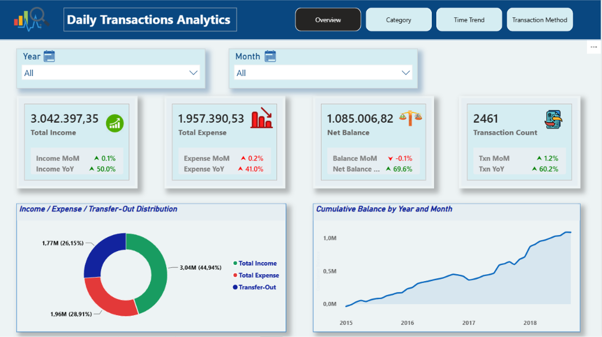
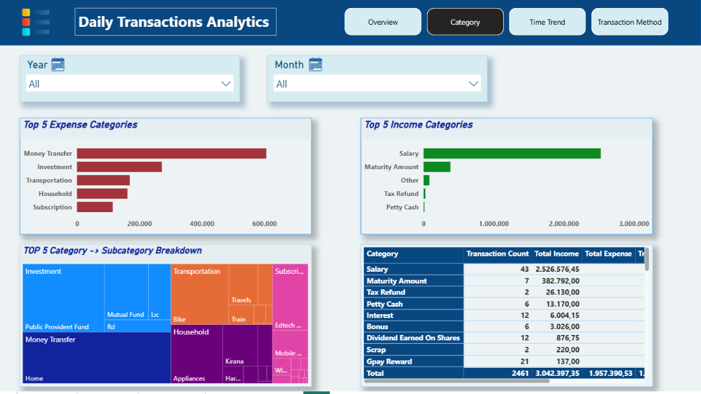
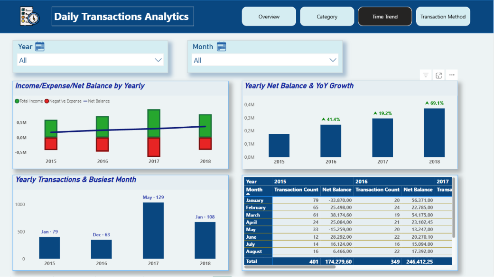
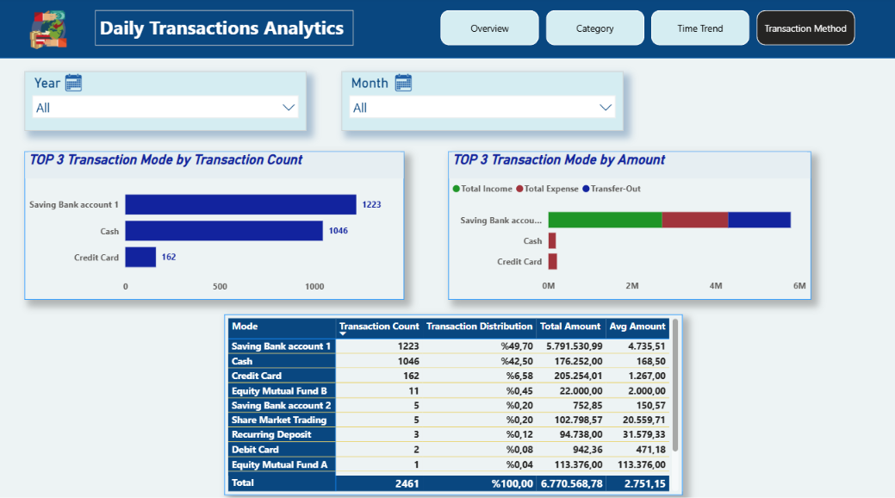

# Daily Transactions Analytics

A personal-finance analytics project built with **SQL Server (T-SQL)**, **Excel** and **Power BI**. It analyzes 2,461 household transactions (Jan 2015 – Sep 2018, INR) to show where money comes from, where it goes, and how the balance changes over time.

## Key Figures

| Metric | Value |
|---|---|
| Total transactions | 2,461 |
| Total income | 3,042,397 |
| Total expense | 1,957,391 |
| Net balance (income − expense) | 1,085,007 |
| Income / expense ratio | 1.55 |

## Power BI Dashboard

### Overview

### Category

### Time Trend

### Transaction Method

The report has four pages, each with slicers and a page navigator:

| Page | What it shows |
|---|---|
| **Overview** | KPI cards, income / expense / transfer-out distribution (donut), trend line |
| **Category** | Top 5 expense and income categories, category → subcategory treemap |
| **Time Trend** | Yearly income, expense and net balance, YoY growth, busiest month per year |
| **Transaction Method** | Top 3 payment modes by count and by amount |

## SQL Analysis

`Daily_Transactions.sql` contains 16 queries (T-SQL) that cover:

1. Amount and count distribution by transaction type
2. Income / expense ratio
3. Top payment modes by count and amount
4. Categories by transaction count
5. Top 5 categories by amount (overall, expense and income)
6. Top 3 subcategories per category with percentage share
7. Monthly transaction count and net amount
8. Busiest months per year
9. Cumulative balance and yearly net balance with YoY change
10. Overall summary

Window functions (`SUM() OVER`, `ROW_NUMBER`, `LAG`) and CTEs are used throughout.

## Dataset

`Daily_Transactions.xlsx` (sheet: *Daily Household Transactions*)

| Column | Description |
|---|---|
| Date | Transaction date and time |
| Mode | Payment method (cash, bank account, credit card, ...) |
| Category / Subcategory | Spending or income category |
| Note | Free-text description |
| Amount | Transaction amount |
| Income/Expense | Income, Expense or Transfer-Out |
| Currency | INR |

> When importing into SQL Server, name the table `daily_transactions` and the column `Income_Expense` (the queries expect these names).

## Findings: The Story Behind the Numbers

### 1. A steady saver with a growing cushion
Over almost four years, income (3.04M) outpaced expenses (1.96M) by a factor of **1.55**, leaving a net balance of about **1.09M**. The savings rate (net ÷ income) tells the real story: **29% in 2015, 34% in 2016, 31% in 2017, and 47% in 2018**. Net balance grew every year (+41% in 2016, +19% in 2017, +26% in 2018), and 2018 already has the highest net of any year even though the data stops on 20 September.

### 2. One paycheck funds almost everything
**Salary** alone brings in 2.53M, about **83% of all income**, from just 43 transactions. The rest is mostly **maturity amounts** (383K, 13%) from matured deposits and investments. Income is highly concentrated, which makes the household resilient as long as the salary continues but exposed if it stops.

### 3. A few big decisions, thousands of small ones
Expenses show two very different behaviors:
- **Everyday spending is tiny.** The median expense is only **83**, and 65% of expense transactions are 200 or less. *Food* alone has 907 transactions (37% of all records) yet accounts for just **4.9% of spending**.
- **A handful of large moves drive the totals.** *Money Transfer* has only 43 transactions but makes up **31% of all expenses** (606K, averaging about 14K each). *Investment* adds another **14%**, led by the Public Provident Fund and mutual funds.

Together, transfers and investments take almost half of every expense dollar, so a large part of what looks like "spending" is really money being moved or put to work. Big-ticket subcategories such as *Home* (205K) and *Bike* (95K) fill most of the rest.

### 4. Money is being put to work
From 2017 the data also records **Transfer-Out** movements: 1.77M in total, mostly into **Fixed Deposit (450K)**, **Share Market (276K)** and a second savings account (275K). This shows a shift from simply saving cash to building a diversified portfolio, and it lines up with the maturity amounts that later show up as income.

### 5. 2017 was the year of activity
Transaction volume jumped from 349 in 2016 to **1,035 in 2017**, the busiest year in the dataset, with **May 2017** alone reaching 129 transactions. Activity eased in 2018 (676 transactions up to September), while the net balance kept climbing, which suggests fewer but more efficient transactions.

### 6. Cash for daily life, the bank account for everything else
**Saving Bank account 1** and **Cash** make up 92% of all transactions (50% and 43%), but they play different roles. Cash handles small daily purchases (only 176K in total), while the bank account carries almost all the money: **5.8M** across income, expenses and transfers. The credit card is used rarely (162 transactions) but for larger purchases, totaling 205K.

### What the dashboard lets you explore
Use the slicers to filter by year and type, then dig into the **Category** page to see which categories dominate, the **Time Trend** page to follow savings year by year, and the **Transaction Method** page to compare how each payment mode is used.

## Repository Files

- 📊 [Power BI report](Daily_Transactions.pbix)
- 🧮 [SQL queries](Daily_Transactions.sql)
- 📗 [Excel dataset](Daily_Transcations.xlsx)
- 🖼️ [Dashboard screenshots](Daily_Transactions_Dashboards)

## How to Use

1. Load `Daily_Transactions.xlsx` into SQL Server and run the queries in `Daily_Transactions.sql`.
2. Open `Daily_Transactions.pbix` in Power BI Desktop to explore the interactive report.

## Tools

SQL Server (T-SQL) · Microsoft Excel · Power BI
